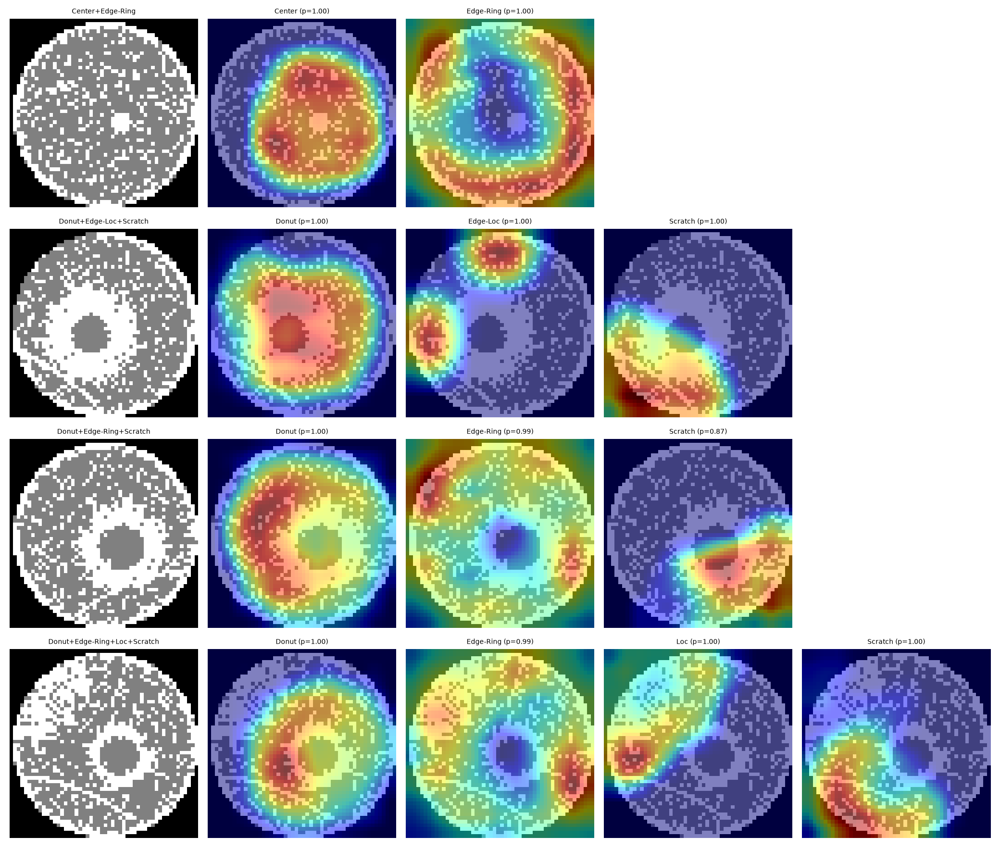
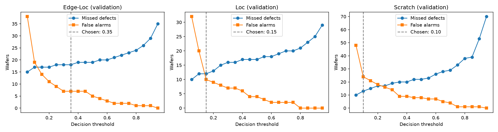
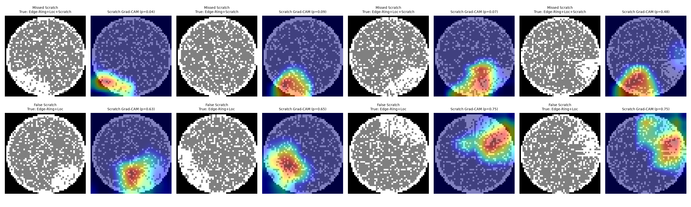

# Mixed-Type Wafer Map Defect Recognition (MixedWM38)

A compact multi-label CNN that detects 8 defect types on semiconductor wafer maps,
including wafers where several defects overlap. The focus is on what matters in
production: missed defects vs. false alarms, behavior on defect combinations never
seen in training, and visual explanations of each decision.

**Status:** analysis complete; ONNX export and web demo in progress.



*One heatmap per defect on the same wafer: each output attends to a different region.*

## Results (held-out test set, 5,549 wafers)

| Metric | Value |
|---|---|
| Macro-F1 over 8 defect types | 0.991 |
| Exact match (all 8 labels correct) | 98.4% |
| Model size | 1.18M parameters |
| Training time | ~5 min on a T4 GPU |

| Defect | Wafers | Precision | Recall | F1 | Missed | False alarms |
|---|---|---|---|---|---|---|
| Center | 1800 | 1.000 | 1.000 | 1.000 | 0 | 0 |
| Donut | 1800 | 1.000 | 1.000 | 1.000 | 0 | 0 |
| Edge-Loc | 1800 | 0.997 | 0.989 | 0.993 | 19 | 5 |
| Edge-Ring | 1800 | 0.994 | 1.000 | 0.997 | 0 | 10 |
| Loc | 2700 | 0.999 | 0.993 | 0.996 | 18 | 4 |
| Near-full | 22 | 0.955 | 0.955 | 0.955 | 1 | 1 |
| Scratch | 2700 | 0.998 | 0.988 | 0.993 | 32 | 6 |
| Random | 127 | 0.992 | 0.992 | 0.992 | 1 | 1 |

Near-full has only 22 test wafers, so its metrics move by 4.5 points per error.

## Key findings

**1. Data issues found before training.** One combination (Center+Edge-Loc+Scratch)
was stored twice in the original file: 1,024 exact duplicates in total. 105 wafers
contained an undocumented pixel value. Duplicates were removed before splitting to
avoid train/test leakage, leaving 36,991 wafers.

**2. Accuracy drops as defects stack up.** Exact match by number of defects on the
wafer: 100% (none), 99.0% (one), 98.7% (two), 98.2% (three), 96.7% (four).

**3. The model misses more than it over-reports.** 71 missed defects vs. 27 false
alarms at the default threshold. The dominant error is a scratch hidden by another
defect.

**4. Thresholds are an operating-point choice, not a free improvement.** Per-defect
thresholds tuned on validation cut missed defects by 38% (71 to 44) but raise false
alarms from 27 to 61. About 10-15 wafers per hard defect type cannot be recovered
at any threshold.



**5. Multi-label generalizes to unseen combinations; a 38-class model cannot.**

| Model | Macro-F1 | Exact match |
|---|---|---|
| Multi-label (8 outputs) | 0.991 | 98.4% |
| Multi-class (38 outputs) | 0.991 | 98.6% |

With all combinations in training the two are equivalent. With four combinations
removed from training, the multi-label model still labels 95.2% of those wafers
fully correctly (97.0% when trained on them). A 38-class classifier scores 0% on
them by construction. Eight defect types allow 256 combinations, so a fab will
eventually produce unseen ones.

**6. Scratch and Loc evidence overlap.** Grad-CAM on error cases shows that dense
local clusters both hide real scratches (missed, p < 0.1) and trigger false ones
(p ≈ 0.7) in the model that never saw that combination without a scratch.



## Limitations

- Single training run per model; differences of a few wafers are within noise.
- Mixed-type patterns in MixedWM38 are partly synthetic, so results on real fab
  data may differ.
- Some remaining errors reflect ambiguous labels (for example a scratch ending in a
  dense cluster labeled as Scratch only).
- Grad-CAM resolution is 13x13, so heatmaps show regions, not exact outlines.

## Approach

- **Data:** MixedWM38, 52x52 wafer maps with 3 die states (no die, pass, fail),
  one-hot encoded into 3 channels. Stratified 70/15/15 split by label combination.
- **Model:** 4 convolutional blocks, global average pooling, 8 sigmoid outputs.
- **Training:** BCE loss, AdamW, one-cycle schedule, 20 epochs, 90-degree rotation
  and flip augmentation.

## Repository structure

```
src/
  explore.py           dataset statistics and sample wafers
  prepare_data.py      cleaning, de-duplication, stratified split
  dataset.py           PyTorch dataset (multi-label and multi-class targets)
  model.py             CNN architecture
  train.py             training (multi-label / multi-class, held-out combinations)
  evaluate.py          test metrics and error analysis
  tune_thresholds.py   per-defect thresholds and trade-off curves
  compare.py           multi-label vs. multi-class comparison
  gradcam.py           Grad-CAM visualizations
notebooks/
  train_colab.ipynb    training on Google Colab
reports/               figures and metrics
```

## Reproduce

```bash
pip install numpy matplotlib scikit-learn torch torchvision

# Download Wafer_Map_Datasets.npz into data/ from
# https://www.kaggle.com/datasets/co1d7era/mixedtype-wafer-defect-datasets

python src/prepare_data.py
python src/train.py --out runs/exp01 --epochs 20
python src/evaluate.py
python src/tune_thresholds.py
python src/gradcam.py
```

## Dataset

MixedWM38 by the Institute of Intelligent Manufacturing, Donghua University
([GitHub](https://github.com/Junliangwangdhu/WaferMap)).